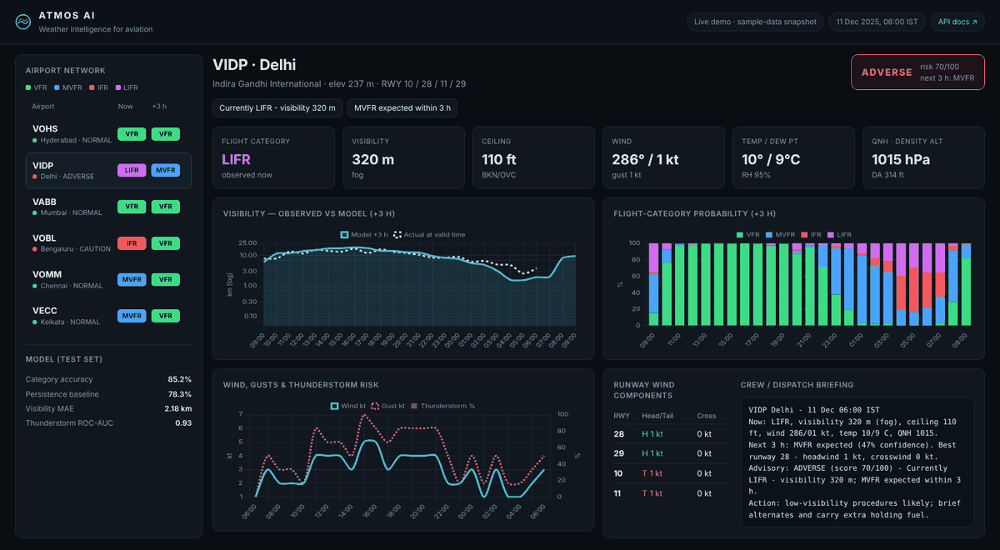

# Atmos AI — Weather Intelligence for Aviation

Atmos AI turns hourly atmospheric data into **flight-category forecasts, thunderstorm risk and
runway-wind advisories** for six major Indian airports, served through a REST API and a live dashboard.

Built as the final project of the **AICTE · IBM SkillsBuild Machine Learning & Applied AI Internship 2026**
(BharatCares, 24 Aug – 30 Sep 2026) by **Abdul Muqsit Mohammed**, B.E. CSE, MJCET Hyderabad.

**Live demo:** https://muq221.github.io/atmos-ai/ &nbsp;·&nbsp; **API docs:** https://muq221.github.io/atmos-ai/api.html &nbsp;·&nbsp; **Code:** https://github.com/muq221/atmos-ai

[](https://muq221.github.io/atmos-ai/)

> The live demo runs fully in the browser on GitHub Pages from a saved snapshot of the API (sample-data mode,
> 11 Dec 2025 06:00 IST). Click any airport on the left to switch. To run the real API, see **Run it** below.

## What it does

| Question a dispatcher asks | Atmos AI answer |
|---|---|
| Is the airport flyable right now? | Current flight category (VFR / MVFR / IFR / LIFR) from visibility and cloud ceiling |
| Will it get worse in the next 3 hours? | Random-Forest classifier → category 3 h ahead with probabilities |
| How bad will visibility get? | Gradient-boosting regressor → visibility 3 h ahead |
| Any thunderstorms coming? | Gradient-boosting classifier → thunderstorm probability (next 3 h) |
| Which runway, and how strong is the crosswind? | Head/tail/crosswind for every runway |
| So what do we do? | NORMAL / CAUTION / ADVERSE advisory + plain-language briefing |

Airports: **VOHS** Hyderabad · **VIDP** Delhi · **VABB** Mumbai · **VOBL** Bengaluru · **VOMM** Chennai · **VECC** Kolkata

## Architecture

```
 Open-Meteo API ─┐                         ┌──────────────── Gold ───────────────┐
 (live/archive)  ├─► Bronze ─► Silver ────►│ 48 features + 3-h-ahead targets      │
 Sample generator┘   raw JSON  validated,   └──────────────┬──────────────────────┘
 (offline mode)                 cleaned,                   │ train (time-based split)
                                ceiling +                  ▼
                                flight cat.     Random Forest · Gradient Boosting (×2)
                                                           │ joblib
                                                           ▼
                         FastAPI service ──► /api/v1/...  ──► Dashboard (Chart.js)
                         advisory engine                    ──► Swagger docs (/docs)
```

* **Data engineering** – medallion layers (bronze → silver → gold) stored as JSON / Parquet,
  range checks, duplicate removal, gap filling (≤ 3 h), derived ceiling and flight category.
* **Machine learning** – scikit-learn, strictly time-based split (train Jan 2024–Aug 2025, test Sep–Dec 2025),
  compared against the *persistence* baseline ("weather stays the same").
* **Serving** – FastAPI + Uvicorn, self-hosted Swagger UI, static dashboard, Docker image, GitHub Actions CI
  and a scheduled data-refresh workflow. The container runs unchanged on IBM Cloud Code Engine or any Docker host.

## Results (test set, Sep–Dec 2025, 17,568 airport-hours)

| Model | Metric | Atmos AI | Persistence baseline |
|---|---|---|---|
| Flight category (+3 h) – Random Forest | Accuracy | **85.2 %** | 78.3 % |
| | Macro F1 | **0.57** | 0.45 |
| Visibility (+3 h) – Gradient Boosting | MAE | **2.18 km** | 3.38 km |
| Thunderstorm (next 3 h) – Gradient Boosting | ROC-AUC | **0.93** | – |

**Real-data check:** the same flight-category method was run on 8,760 real hourly observations from
Greensboro Piedmont Triad International Airport (NREL TMY3, bundled with `pvlib`). With only one year of data
it matched the persistence baseline (≈78 % accuracy) – a reminder that more real history and NWP inputs are
needed before operational use. See `scripts/validate_real_obs.py`.

> **Data note.** By default the project runs in *sample mode*: an offline generator produces data in the exact
> Open-Meteo format, driven by monthly climate normals of each airport (monsoon rain, winter fog, pre-monsoon
> thunderstorms). It is **not observed data**. Set `ATMOS_SOURCE=openmeteo` to pull real data – no API key needed.

## Run it

```bash
git clone https://github.com/muq221/atmos-ai.git && cd atmos-ai
python -m venv .venv && source .venv/bin/activate      # Windows: .venv\Scripts\activate
pip install -r requirements.txt

python -m atmos.pipeline.run          # bronze -> silver -> gold
python -m atmos.models.train          # trains + evaluates, writes models/metrics.json
uvicorn atmos.api.app:app --reload    # dashboard http://127.0.0.1:8000  ·  docs /docs
pytest -q                             # 16 tests
```

Live data instead of sample data:

```bash
export ATMOS_SOURCE=openmeteo
python -m atmos.pipeline.run --source openmeteo --start 2024-01-01 --end 2025-12-31
python -m atmos.models.train
uvicorn atmos.api.app:app
```

Docker: `docker compose up --build`

## Publish the live demo (GitHub Pages)

```bash
python scripts/build_static_demo.py   # refreshes docs/ from the API (after pipeline + training)
git add docs && git commit -m "Update demo" && git push
```

On GitHub: **Settings → Pages → Build and deployment → Source: Deploy from a branch → Branch: `main`, folder: `/docs` → Save.**
The demo appears at `https://muq221.github.io/atmos-ai/` within 1–2 minutes.

## API

| Endpoint | Returns |
|---|---|
| `GET /api/v1/health` | service status, data mode, model timestamp |
| `GET /api/v1/airports` | airport list with runways |
| `GET /api/v1/airports/{icao}/current` | latest conditions + flight category |
| `GET /api/v1/airports/{icao}/forecast?hours=24` | hourly ML predictions (each valid +3 h) |
| `GET /api/v1/airports/{icao}/advisory` | NORMAL / CAUTION / ADVERSE + reasons + runway winds |
| `GET /api/v1/airports/{icao}/briefing` | plain-language briefing text |
| `GET /api/v1/network` | one-line status for all airports |
| `GET /api/v1/models` | training metadata and test metrics |

## Project layout

```
atmos/
  config.py            airports, runways, thresholds, paths
  ingest/openmeteo.py  Open-Meteo client (forecast + historical)
  ingest/sample.py     offline climatology-driven sample generator
  pipeline/layers.py   bronze -> silver -> gold
  pipeline/run.py      pipeline CLI
  aviation/rules.py    flight categories, wind components, density altitude, advisory
  models/train.py      training + evaluation
  api/service.py       serving logic
  api/app.py           FastAPI routes
  dashboard/static/    HTML/CSS/JS dashboard
scripts/validate_real_obs.py   real-airport-data check
tests/                         pytest suite
```

## Limitations

Decision-support prototype only — **not** a replacement for official IMD METAR/TAF or ATC instructions.
Ceiling is estimated from temperature/dew-point spread and low-cloud cover, not measured.

## Acknowledgements

AICTE, IBM SkillsBuild and BharatCares for the internship; Open-Meteo for the free weather API;
NREL for the TMY3 dataset; MJCET CSE department for guidance.
